# Contract Audit & Canonical Booking Specification

> **Document:** `docs/contracts/booking-flow.md`  
> **Status:** Authoritative Design & Integration Contract  
> **Target Release:** Unified Booking Flow (FE + Mobile + BE)

---

## 1. Executive Summary & Ruling

### 1.1 The Canonical Decision
Between the two existing backend modules—`booking` (`/api/bookings`, `store_booking_configs`, `table_categories`, `bookings`) and `reservation` (`/api/reservations`, `reservations`, `store_tables`):
- **Canonical Booking Module:** `com.moodcafe.booking` and its database tables (`bookings`, `store_booking_configs`, `table_categories`) are established as the **single source of truth** for all new customer reservations and store desk operations.
- **Legacy Compatibility:** Existing `reservations` table and endpoints (`/api/reservations`, `/merchant/stores/{storeId}/reservations`) are retained strictly for historical read-only access and legacy payment attempt reconciliations. **Neither FE nor Mobile shall create reservations in parallel.**
- **Financial Life-cycle Unification:** The robust financial infrastructure introduced in V41–V44 (`com.moodcafe.finance`, `com.moodcafe.wallet`, `com.moodcafe.voucher`, `com.moodcafe.loyalty`, and `payment_attempts`) is linked directly to `Booking`.

---

## 2. Inventory & Mapping of Existing Callers and Endpoints

### 2.1 Backend Endpoints

| Existing Endpoint | Module | Current Status & Behavior | Target Strategy |
|---|---|---|---|
| `GET /api/stores/{storeId}/schedule` | `booking` | Returns time slots, quotas, opening/closing, min-advance from `store_booking_configs`. | **Keep as primary** schedule source. |
| `GET /api/stores/{storeId}/table-categories/active` | `booking` | Returns active categories with capacity, quota, min spend. | **Keep as primary** category source. |
| `GET /api/stores/{storeId}/booking-availability` | `booking` | Checks remaining quota for category at instant. | **Keep** for availability check. |
| `POST /api/bookings/quote` | `booking` | *(Non-existent)* | **NEW (Task 1):** Pre-calculate gross, voucher discount, customer-paid, snapshot version. |
| `POST /api/bookings` | `booking` | Creates `Booking` record with `PENDING_PAYMENT`, calls PayOS. Lacks voucher, quote validation, financial snapshot, and durable idempotency. | **Upgrade (Task 1–2):** Add `Idempotency-Key`, quote binding, voucher lock, immutable financial snapshot, and `PaymentAttempt` coordination. |
| `GET /api/bookings/{bookingId}` | `booking` | Returns `BookingResponse`. Open to any authenticated user. | **Secure & Enrich (Task 1):** Customer ownership check; return `BookingCustomerDetail` (no owner net/commission). |
| `GET /api/bookings/code/{bookingCode}` | `booking` | Public endpoint returning full response. | **Sanitize (Task 1):** Redact PII and internal sensitive financial fields. |
| `POST /api/bookings/{bookingId}/payment-link` | `booking` | Re-creates payment link if pending. | **Upgrade (Task 3):** Reconcile against durable `payment_attempts` with same `orderCode`. |
| `POST /api/bookings/{bookingId}/cancel` | `booking` | Sets `CANCELLED` and `refundProcessed = false`. No points refund or voucher restoration. | **Upgrade (Task 4):** Atomic refund to Customer MoodPoints (1 pt = 1 VND), voucher unlock/restoration, slot release, merchant pending reversal. |
| `GET /api/bookings/my` | `booking` | Lists customer's bookings with pagination. | **Upgrade (Task 1):** Standardize `BookingPage` envelope and status filters. |
| `POST /api/bookings/{bookingId}/self-check-in` | `booking` | *(Non-existent)* | **NEW (Task 4):** Verify store physical QR, update to `CHECKED_IN`, trigger on-time check-in loyalty points if within threshold. |
| `POST /api/bookings/{bookingId}/self-check-out` | `booking` | *(Non-existent)* | **NEW (Task 4):** Verify store checkout QR, check duration >= 30 mins, mark `COMPLETED`, release Pending -> Available balance, award checkout points. |
| `GET /api/stores/{storeId}/bookings` | `booking` | Store desk list by date range. | **Keep & Enrich (Task 12):** Return `BookingStaffDetail` (grossAmount visible; net/commission hidden). |
| `GET /api/stores/{storeId}/bookings/summary` | `booking` | Store desk summary (counts, gross min spend). | **Keep (Task 12):** Support desk status overview. |
| `POST /api/stores/{storeId}/bookings/check-in` | `booking` | Desk check-in by booking code. | **Upgrade (Task 4):** Transition to `CHECKED_IN`, trigger on-time check-in bonus, keep funds in Pending. |
| `POST /api/stores/{storeId}/bookings/{bookingId}/claim-late` | `booking` | Desk late-claim. | **Upgrade (Task 4):** Transition to `CLAIMED_LATE`, trigger merchant settlement to Available, award Spend points, no on-time bonus. |
| `POST /api/stores/{storeId}/bookings/{bookingId}/complete` | `booking` | Desk complete. | **Upgrade (Task 4):** Transition to `COMPLETED`, release Pending to Available in merchant wallet, award Spend points. |
| `/api/reservations/*` & `/merchant/stores/{id}/reservations` | `reservation` | Full duplicate flow built in V41-V44. | **Freeze / Read-Only:** Map merchant UI to canonical bookings; preserve existing records for audit. |

---

## 3. Financial Life-cycle & State Machine

```mermaid
stateDiagram-v2
    [*] --> PENDING_PAYMENT: POST /api/bookings (Quote validated, Voucher LOCKED, Slot reserved)
    PENDING_PAYMENT --> PAID_CONFIRMED: Webhook / Polling / Zero-Pay (Voucher USED, Merchant PENDING credited)
    PENDING_PAYMENT --> PAYMENT_FAILED: PayOS Expired / Cancelled / TTL (Voucher UNLOCKED, Slot released)
    PENDING_PAYMENT --> CANCELLED: Customer cancels before payment (Voucher UNLOCKED, Slot released)
    
    PAID_CONFIRMED --> CHECKED_IN: Staff Check-in / Self Check-in QR (On-time bonus awarded; Funds stay PENDING)
    PAID_CONFIRMED --> TABLE_EXPIRED: Grace period elapsed without arrival (Slot released to walk-ins; Funds stay PENDING)
    PAID_CONFIRMED --> CANCELLED_REFUNDED: Customer cancels before Free Cancel Deadline (Pending reversed; 1:1 Refund Points credited; Voucher RESTORED; Slot released)
    
    TABLE_EXPIRED --> CLAIMED_LATE: Customer arrives late before closing (Merchant PENDING -> AVAILABLE; Spend Points awarded)
    TABLE_EXPIRED --> EXPIRED_NO_SHOW: End of business day without arrival (Merchant PENDING -> AVAILABLE; 0 points to customer)
    
    CHECKED_IN --> COMPLETED: Staff Complete / Self Checkout QR >= 30m (Merchant PENDING -> AVAILABLE; Spend Points + Checkout Bonus awarded)
```



---

## 4. Database Schema Additions & Additive Migration (V45)

To bridge `bookings` with the financial architecture without breaking existing V1–V44 migrations or historical data:

1. **`bookings` table additions:**
   - `guest_count INT NOT NULL DEFAULT 2`
   - `quote_id UUID REFERENCES booking_quotes(quote_id)`
   - `gross_amount NUMERIC(12, 2) NOT NULL DEFAULT 0.00`
   - `voucher_discount NUMERIC(12, 2) NOT NULL DEFAULT 0.00`
   - `customer_paid_amount NUMERIC(12, 2) NOT NULL DEFAULT 0.00`
   - `commission_amount NUMERIC(12, 2) NOT NULL DEFAULT 0.00`
   - `merchant_net_amount NUMERIC(12, 2) NOT NULL DEFAULT 0.00`
   - `voucher_id UUID REFERENCES customer_vouchers(voucher_id) ON DELETE SET NULL`
   - `voucher_refund_funded_amount NUMERIC(12, 2) NOT NULL DEFAULT 0.00`
   - `voucher_reward_funded_amount NUMERIC(12, 2) NOT NULL DEFAULT 0.00`
   - `commission_rate_snapshot NUMERIC(5, 4) NOT NULL DEFAULT 0.1500`
   - `actual_paid_amount NUMERIC(12, 2) NOT NULL DEFAULT 0.00`
   - `paid_at TIMESTAMPTZ`
   - `grace_deadline TIMESTAMPTZ`
   - `service_closing_deadline TIMESTAMPTZ`
   - `free_cancel_deadline TIMESTAMPTZ`
   - `version BIGINT NOT NULL DEFAULT 0`

2. **`booking_quotes` table:**
   - `quote_id UUID PRIMARY KEY DEFAULT gen_random_uuid()`
   - `user_id UUID NOT NULL REFERENCES users(user_id) ON DELETE CASCADE`
   - `store_id UUID NOT NULL REFERENCES stores(store_id) ON DELETE CASCADE`
   - `category_id UUID NOT NULL REFERENCES table_categories(category_id) ON DELETE CASCADE`
   - `start_time TIMESTAMPTZ NOT NULL`
   - `guest_count INT NOT NULL`
   - `voucher_id UUID REFERENCES customer_vouchers(voucher_id) ON DELETE SET NULL`
   - `selection_fingerprint VARCHAR(64) NOT NULL`
   - `pricing_version INT NOT NULL DEFAULT 1`
   - `gross_amount NUMERIC(12, 2) NOT NULL`
   - `voucher_discount NUMERIC(12, 2) NOT NULL`
   - `customer_paid_amount NUMERIC(12, 2) NOT NULL`
   - `commission_rate NUMERIC(5, 4) NOT NULL`
   - `is_eligible BOOLEAN NOT NULL DEFAULT TRUE`
   - `ineligibility_reason TEXT`
   - `free_cancel_deadline TIMESTAMPTZ NOT NULL`
   - `grace_deadline TIMESTAMPTZ NOT NULL`
   - `service_closing_deadline TIMESTAMPTZ NOT NULL`
   - `expires_at TIMESTAMPTZ NOT NULL`
   - `created_at TIMESTAMPTZ NOT NULL DEFAULT CURRENT_TIMESTAMP`

3. **`customer_vouchers` additions:**
   - `locked_booking_id UUID REFERENCES bookings(booking_id) ON DELETE SET NULL`
   - Constraint: `CHECK (locked_reservation_id IS NULL OR locked_booking_id IS NULL)`

4. **`reservation_loyalty_rewards` additions:**
   - `booking_id UUID REFERENCES bookings(booking_id) ON DELETE CASCADE`
   - Make `reservation_id` nullable.
   - Constraint: `CHECK ((reservation_id IS NOT NULL AND booking_id IS NULL) OR (reservation_id IS NULL AND booking_id IS NOT NULL))`
   - Unique constraints:
     - `uq_booking_loyalty_reward UNIQUE (booking_id, reward_type)`
     - `uq_reservation_reward_type UNIQUE (reservation_id, reward_type)`

5. **`payment_attempts` integration:**
   - Supports both `purpose = 'BOOKING'` where `business_id` is either `booking_id` or legacy `reservation_id`.

6. **`reviews` table additions:**
   - `booking_id UUID REFERENCES bookings(booking_id) ON DELETE SET NULL`
   - Constraint: at most 1 verified review reward per booking.

---

## 5. API Data Transfer Objects (DTO) Specifications

### 5.1 Customer Quote Request & Response
- **Endpoint:** `POST /api/bookings/quote`
- **Request Body:**
  ```json
  {
    "storeId": "UUID",
    "categoryId": "UUID",
    "startTime": "2026-10-25T14:30:00Z",
    "guestCount": 2,
    "voucherId": "UUID (optional)"
  }
  ```
- **Response Body (`BookingQuote`):**
  ```json
  {
    "quoteId": "UUID",
    "expiresAt": "2026-10-25T14:15:00Z",
    "selectionFingerprint": "sha256-hex",
    "pricingVersion": 1,
    "grossAmount": 100000,
    "voucherDiscount": 20000,
    "customerPaidAmount": 80000,
    "currency": "VND",
    "isEligible": true,
    "ineligibilityReasons": [],
    "freeCancelDeadline": "2026-10-25T12:30:00Z",
    "graceDeadline": "2026-10-25T15:00:00Z",
    "serviceClosingDeadline": "2026-10-25T22:00:00Z"
  }
  ```

### 5.2 Create Booking Request & Response
- **Endpoint:** `POST /api/bookings`
- **Headers:** `Idempotency-Key: <string>`
- **Request Body (`CreateBookingRequest`):**
  ```json
  {
    "storeId": "UUID",
    "categoryId": "UUID",
    "startTime": "2026-10-25T14:30:00Z",
    "guestCount": 2,
    "customerName": "Nguyen Van A",
    "customerPhone": "0901234567",
    "customerEmail": "a@example.com",
    "note": "Ban gan cua so",
    "quoteId": "UUID",
    "voucherId": "UUID (optional)"
  }
  ```
- **Response Body (`BookingCustomerDetail`):**
  ```json
  {
    "bookingId": "UUID",
    "bookingCode": "MC8F1A2B",
    "storeId": "UUID",
    "storeName": "Mood Cafe Saigon",
    "categoryId": "UUID",
    "categoryName": "Ban 2 nguoi",
    "customerName": "Nguyen Van A",
    "customerPhone": "0901234567",
    "customerEmail": "a@example.com",
    "guestCount": 2,
    "startTime": "2026-10-25T14:30:00Z",
    "endTime": "2026-10-25T16:30:00Z",
    "status": "PENDING_PAYMENT",
    "grossAmount": 100000,
    "voucherDiscount": 20000,
    "customerPaidAmount": 80000,
    "actualPaidAmount": 0,
    "paymentOrderCode": 2000000123,
    "paymentStatus": "PENDING",
    "checkoutUrl": "https://pay.payos.vn/...",
    "qrCode": "vietqr...",
    "qrCodeToken": "secret-token-for-staff-scan",
    "freeCancelDeadline": "2026-10-25T12:30:00Z",
    "graceDeadline": "2026-10-25T15:00:00Z",
    "serviceClosingDeadline": "2026-10-25T22:00:00Z",
    "allowedActions": ["PAY", "CANCEL"],
    "refundOutcome": null,
    "createdAt": "2026-10-23T02:00:00Z"
  }
  ```

### 5.3 Staff Detail Response (`BookingStaffDetail`)
- **Note:** Excludes `commissionAmount`, `merchantNetAmount`, `voucherDiscount`, and payment funding details.
  ```json
  {
    "bookingId": "UUID",
    "bookingCode": "MC8F1A2B",
    "customerName": "Nguyen Van A",
    "customerPhone": "0901234567",
    "guestCount": 2,
    "categoryName": "Ban 2 nguoi",
    "startTime": "2026-10-25T14:30:00Z",
    "endTime": "2026-10-25T16:30:00Z",
    "status": "PAID_CONFIRMED",
    "grossAmount": 100000,
    "graceDeadline": "2026-10-25T15:00:00Z",
    "serviceClosingDeadline": "2026-10-25T22:00:00Z",
    "allowedActions": ["CHECK_IN", "CANCEL"]
  }
  ```

---

## 6. Role & Access Control Matrix

| Role | Permitted Actions | Visible Data |
|---|---|---|
| **CUSTOMER** | Request Quote, Create Booking, Pay (PayOS / Zero-Pay), Cancel (within deadline), Self Check-In, Self Check-Out, Review. | Own bookings, gross, discount, paid amount, QR/token. **Forbidden:** store commission, merchant net balance. |
| **STAFF / CASHIER / MANAGER** | Search bookings for store, Desk Check-In, Claim-Late, Desk Complete, View desk summary. | Customer name, phone, guestCount, gross F&B credit, status, deadlines. **Forbidden:** platform commission, net payout, bank accounts, withdrawals. |
| **STORE OWNER** | All staff actions + Merchant Wallet view, Bank Account management, Withdrawal Request creation. | Full store booking list, Pending/Available balances, gross, net, commission per store. |
| **ADMIN** | Platform commission policy configuration, Withdrawal claim & processing/rejection with audit proofs. | Cross-store financial reports, audit logs, withdrawal resolution. |

---

## 7. Migration & Cutover Verification Gate

1. **Schema Non-Destructive Update:** V45 additive script executes against database; hibernate validation passes without error.
2. **Double-Entity Prevention:** Ensure no dual-creation logic in controllers or coordinator.
3. **PayOS Webhook Routing:** Authoritatively route via `PaymentAttempt` `orderCode` -> checks `bookings` first, falls back to legacy `reservations`.
4. **Zero-Pay Safe Processing:** When `customerPaidAmount == 0`, immediately transition to `PAID_CONFIRMED`, credit Merchant Pending, mark Voucher USED without contacting PayOS.
